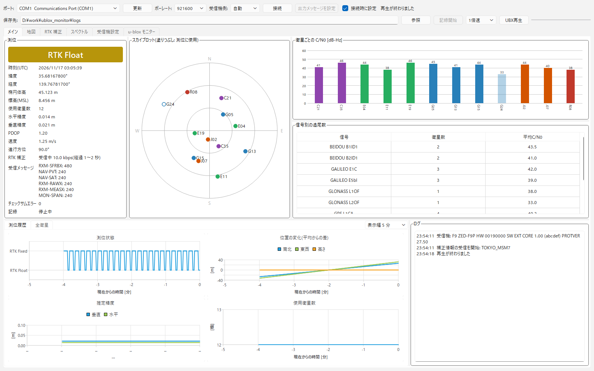
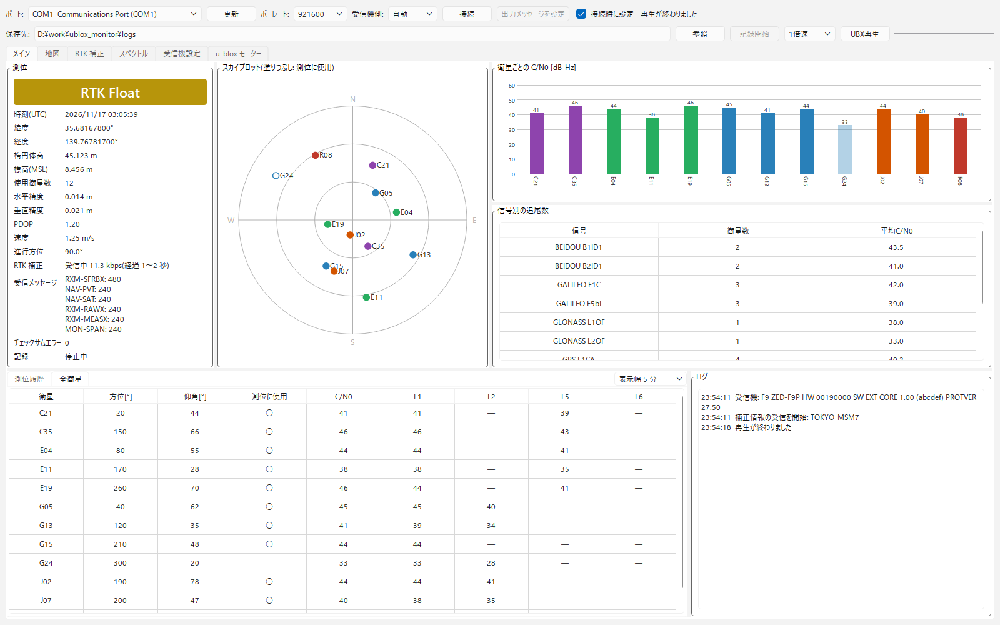
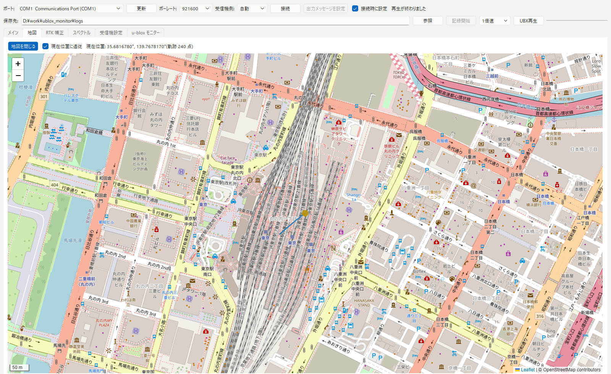
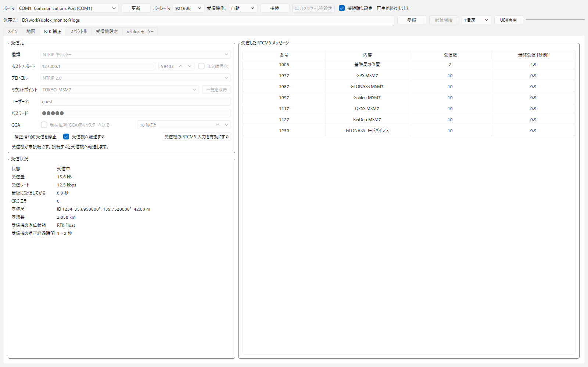
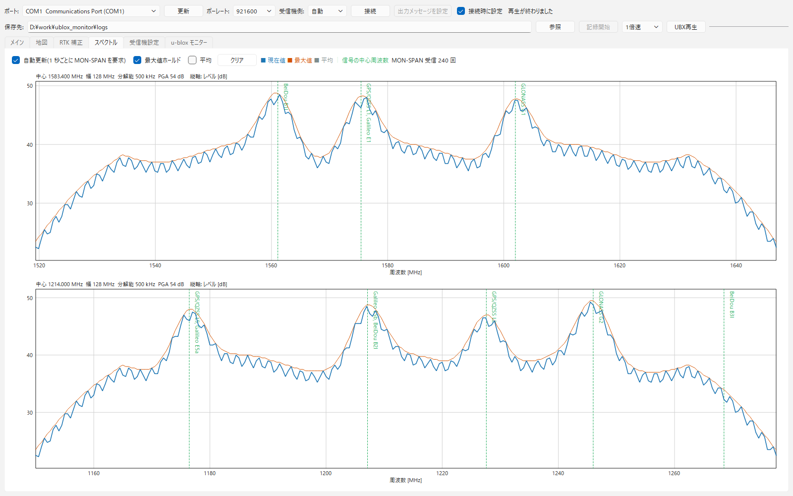
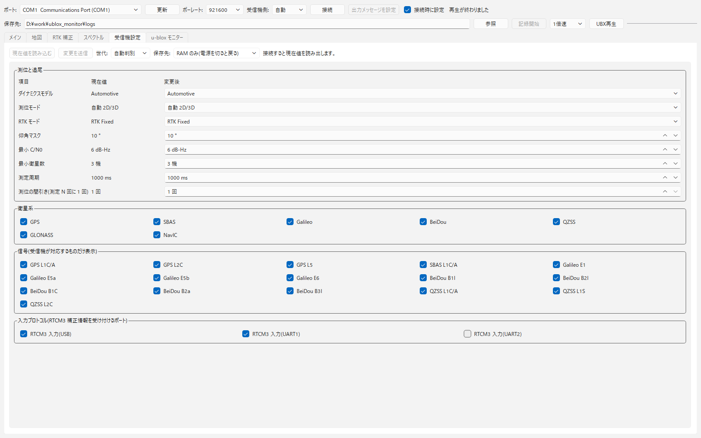
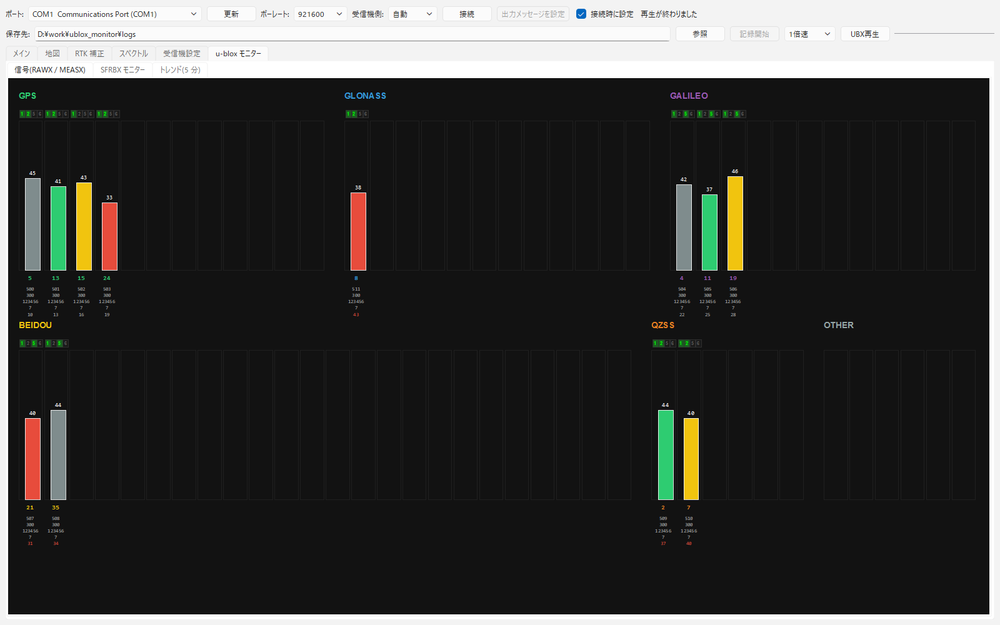
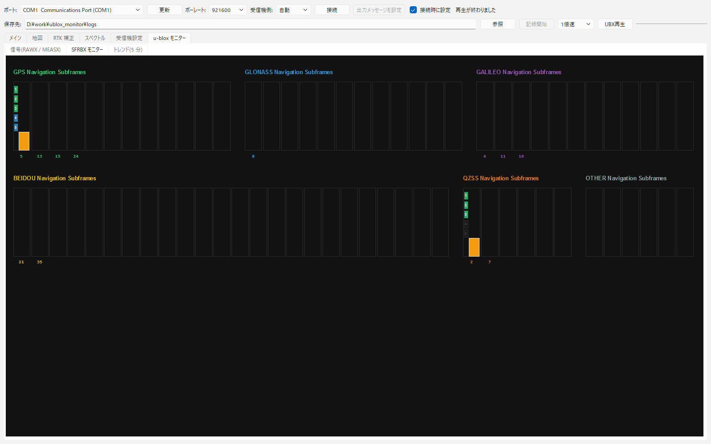
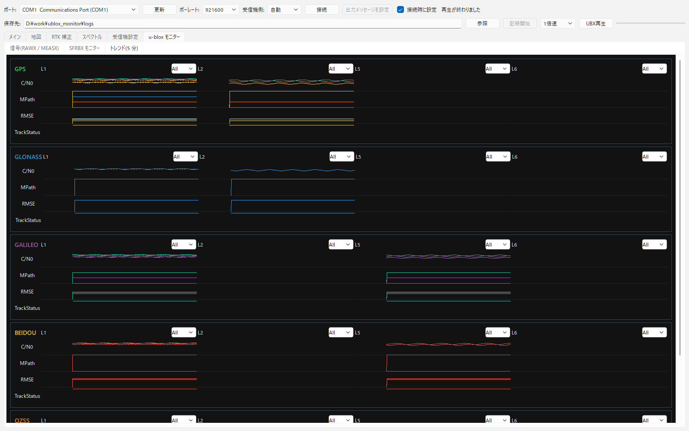

# u-blox-Monitor **Version:** 0.3.0
**Author:** Rei Furukawa (kijitora-no-hito)

u-blox 受信機(M8 / F9 / X20 シリーズ)用の記録・表示・設定・解析ツールです。Python で実装しています。
測位状態や衛星の受信状況、地図上の軌跡、RF のスペクトルを表示し、受信機の設定を変更できます。
NTRIP などで受けた RTCM 補正情報を受信機へ送り、RTK 測位ができます。
RAW データ(MEASX、SFRBX、RAWX など)を記録して、受信機の性能をグラフで解析できます。



**ライセンス**
[MIT ライセンス](LICENSE)で公開しています。

**コントリビューションについて**
個人のプロジェクトのため、コントリビューションは受け付けていません。Issue は無効にしています。

- プルリクエストはレビューせずにクローズします。
- サポートや機能の要望には対応しません。

コードはご自由にお使いください。ただし、返信や保守は期待しないでください。

**例外**
個人的なつながりのある方(日本の測位航法関係の学会で議論した方など)からの依頼には、個別に対応することがあります。

## 使い方

### 1. インストール

#### インストーラ版

1. [Releases](https://github.com/kijitora-no-hito/u-blox-Monitor/releases) から `ublox_monitor_Setup_<バージョン>.exe` をダウンロードして実行する。管理者権限は要りません。
2. スタートメニューに「u-blox Monitor」が追加されます(デスクトップのアイコンはインストール時に選べます)。

記録の既定の保存先は「ドキュメント\ublox_monitor」です。アンインストールは Windows の「インストールされているアプリ」から行えます。

#### ソースから実行する場合

- Windows 11
- Python 3.11 以降

必要なパッケージ(PySide6、pyserial)をインストールして起動します。

```
pip install -r requirements.txt
python ubxMonitor.py
```

`python -m ublox_monitor` でも起動できます。記録の既定の保存先は、起動したフォルダの `logs` です。

#### インストーラを作る場合

[PyInstaller](https://pyinstaller.org/)(`pip install pyinstaller`)と [Inno Setup 6](https://jrsoftware.org/isinfo.php) を入れてから、リポジトリのルートで次を実行します。`packaging\Output\` にインストーラができます。

```
powershell -ExecutionPolicy Bypass -File packaging\build.ps1
```

---

### 2. 準備

- u-blox の USB ドライバを PC にインストールする
- u-blox 受信機を USB で PC につなぐ

---

### 3. 起動

スタートメニューの「u-blox Monitor」から起動します(ソースからの場合は `python ubxMonitor.py`)。

---

### 4. 操作

1. ポートとボーレートを選び、**接続** を押す。
   - 受信機の世代(M8 / F9 / X20)は UBX-MON-VER の応答から判別します。
   - **接続時に設定** にチェックが入っていると(既定)、接続中のポートに NAV-PVT、NAV-SAT、RXM-RAWX、RXM-SFRBX、RXM-MEASX を出力するよう設定します。変更するのは RAM だけなので、電源を入れ直すと保存済みの設定に戻ります。
   - 接続時に受信機の設定を変えたくない場合は、チェックを外してください。**出力メッセージを設定** を押すと、同じ設定を手動で送れます。
   - **受信機側** は、PC がつながっている受信機側のポート(USB / UART1 / UART2)です。「自動」の場合、u-blox の USB ポートなら USB、USB シリアル変換なら UART1 とみなします。
2. **記録開始** を押すと、受信したデータを `logs/ublox_年月日_時分秒.ubx` にそのまま保存します。保存先は **参照** で変えられます。既存のファイルは上書きしません。
3. **UBX再生** を押すと、記録済みの `.ubx` ファイルを 1 倍速 / 10 倍速 / 60 倍速 / 最大の速度で再生します。実機が無くても画面を確認できます。

### 5. 画面

画像は、テスト用に作ったサンプルデータを再生したときのものです。

| タブ | 内容 |
|---|---|
| **メイン** | 受信機の一般的な表示。測位状態(No Fix / 3D / DGNSS / RTK Float / RTK Fixed)、時刻、位置、精度、PDOP、速度、スカイプロット、衛星ごとの C/N0、信号別の追尾数、測位履歴のグラフ、全衛星の表、ログ |
| **地図** | 現在位置と軌跡を OpenStreetMap 上に表示 |
| **RTK 補正** | NTRIP キャスター / TCP サーバ / シリアルポートから RTCM 補正情報を受信し、受信機へ転送 |
| **スペクトル** | 受信機の RF スペクトル(UBX-MON-SPAN)を表示 |
| **受信機設定** | 受信機の設定の読み出しと変更 |
| **u-blox モニター** | 従来の u-blox Monitor の表示(RAWX / MEASX の信号、SFRBX モニター、5 分間のトレンド) |

#### メイン

- 測位: 測位状態を色付きで大きく表示し、時刻(UTC)、緯度経度、楕円体高、標高、使用衛星数、推定精度、PDOP、速度、進行方位、受信メッセージ数を表示します。
- スカイプロット: 衛星の配置を表示します。測位に使っている衛星は塗りつぶしで表示します。
- 衛星ごとの C/N0: 測位に使っている衛星は濃く、それ以外は薄く表示します。
- 測位履歴: 測位状態、位置の変化(平均位置からの差)、推定精度、使用衛星数の時系列を表示します。表示幅は右上で 1 分 / 5 分 / 15 分 / 1 時間 / 全期間から選べます。
- 全衛星: 衛星ごとの方位、仰角、測位への使用、帯域(L1 / L2 / L5 / L6)ごとの C/N0 を表示します。



#### 地図

**地図を表示** を押すまで地図は読み込みません。表示すると Leaflet(unpkg.com)と地図タイル(tile.openstreetmap.org)をインターネットから取得するため、表示している場所の概略が地図サーバに伝わります。**地図を閉じる** を押すと接続を止めます。

**現在位置に追従** にチェックを入れると、現在位置が画面の外に出たときに地図を移動します。現在位置の印は測位状態の色で表示します。



#### RTK 補正

RTCM3 の補正情報を受信して、接続中の受信機へ転送します。受信機が RTK Float / RTK Fixed になるには、受信機が RTCM3 を受け付ける設定になっている必要があります。

1. 受信元を選ぶ。
   - **NTRIP キャスター**: ホスト、ポート(既定 2101)、マウントポイント、ユーザー名、パスワードを入れる。**一覧を取得** でキャスターのマウントポイントの一覧(ソーステーブル)を取得できます。NTRIP 1.0 / 2.0 と TLS に対応しています。
   - **TCP サーバ**: RTCM3 をそのまま流しているサーバのホストとポートを入れる。
   - **シリアルポート(無線機など)**: 基準局からの無線機などがつながっている COM ポートとボーレートを選ぶ。
2. VRS など、利用者の位置が必要なマウントポイントでは **現在位置(GGA)をキャスターへ送る** にチェックを入れる。受信機の NAV-PVT の位置を指定の間隔で送ります(位置情報がキャスターに伝わります)。
3. **補正情報の受信を開始** を押す。**受信機へ転送する** にチェックが入っていると、受信したデータをそのまま受信機へ送ります。
4. 受信機が RTCM3 を受け付けていない場合は、**受信機の RTCM3 入力を有効にする** を押す。接続中のポート(「受信機側」で選んだもの)で RTCM3 の入力を有効にします(RAM のみ。F9 / X20 のみ)。受信機設定タブの「入力プロトコル」でも確認・変更できます。

受信状況として、受信量、受信レート、CRC エラー、受信した RTCM3 メッセージの番号と受信数を表示します。基準局の位置(1005 / 1006)が届くと、基準局の座標と現在位置までの基線長も表示します。受信機側の補正経過時間は NAV-PVT の値です(対応するファームウェアのみ)。

入力内容は次回の起動時に復元します。パスワードは保存しません。



#### スペクトル

受信機の RF ブロックごとのスペクトルを表示します。表示中は 1 秒ごとに UBX-MON-SPAN を受信機に要求します(Poll なので受信機の設定は変えません)。現在値、最大値ホールド、平均を重ねて表示でき、主な信号の中心周波数に目印を付けます。グラフ上にマウスを置くと、その周波数とレベルを表示します。

MON-SPAN に対応するのは F9 世代の比較的新しいファームウェアなどで、古いファームウェアや M8 では表示できません(応答が無い場合はその旨を表示します)。記録済みのログに MON-SPAN が含まれていれば、再生時にも表示します。



#### 受信機設定

接続すると現在値を自動で読み出します。**現在値を読み込む** で読み直せます。
変更したい項目を選んで **変更を送信** を押すと、確認画面のあとで変更した項目だけを送り、値を読み直します。受信機が受け付けたか(ACK / NAK)はタブ内に表示します。

- 測位と追尾: ダイナミクスモデル、測位モード、RTK モード、仰角マスク、最小 C/N0、最小衛星数、測定周期、測位の間引き
- 衛星系 / 信号: 衛星系と信号の有効 / 無効を切り替えます。信号は受信機が対応するものだけ表示します。変更すると衛星の追尾がいったん止まり、再捕捉が始まります。
- 保存先: 「RAM のみ」(電源を切ると戻る。既定)または「RAM + BBR + Flash」(保存する)
- 入力プロトコル: USB / UART1 / UART2 のそれぞれで RTCM3 補正情報を受け付けるかを切り替えます。
- 世代: 通常は「自動判別」のままにしてください。MON-VER の応答が無い場合は手動で選びます。

F9 / X20 は設定キー(UBX-CFG-VALGET / VALSET)で読み書きします。
M8 は UBX-CFG-NAV5 / CFG-RATE で読み書きします。M8 では衛星系と信号は変更できず、変更は現在の設定(RAM)にだけ反映します。



#### u-blox モニター

**信号(RAWX / MEASX)** は、RAWX と MEASX から得た信号の受信状況を表示します。棒の高さが C/N0、色がマルチパスの指標、上の小さな枠が帯域(L1 / L2 / L5 / L6)ごとの追尾状態です。棒の下には MEASX の値(wChips、fChips、cPhase、iPhase、RMSE)を表示します。



**SFRBX モニター** は、航法メッセージの受信状況を表示します。GPS / QZSS の L1C/A は、受信したサブフレームの番号も表示します。



**トレンド(5 分)** は、直近 5 分間の C/N0、マルチパス、RMSE、追尾状態を衛星系と帯域ごとに表示します。右上のプルダウンで衛星を絞り込めます。



---

### 構成

| ファイル | 役割 |
|---|---|
| `ublox_monitor/ubx.py` | UBX の分離(チェックサム検査)、デコード、パケットの組み立て |
| `ublox_monitor/state.py` | 受信メッセージの集計 |
| `ublox_monitor/serial_link.py` | シリアル通信、再生、記録 |
| `ublox_monitor/settings.py` | 受信機設定の項目、設定パケット、設定画面 |
| `ublox_monitor/charts.py` | グラフ、スカイプロット、C/N0 の棒グラフ |
| `ublox_monitor/map_view.py` | 地図 |
| `ublox_monitor/rtcm.py` | RTCM 補正情報の受信(NTRIP / TCP / シリアル)と RTCM3 の解析 |
| `ublox_monitor/correction_view.py` | RTK 補正 |
| `ublox_monitor/spectrum_view.py` | スペクトル |
| `packaging/` | exe とインストーラの作成(PyInstaller、Inno Setup) |
| `ublox_monitor/monitor_view.py` | u-blox モニター |
| `ublox_monitor/app.py` | メインウィンドウ |

テストは `python -m pytest tests` で実行します。

---

### 補足

MIT ライセンスで公開しています。ご自由にお使いください。
